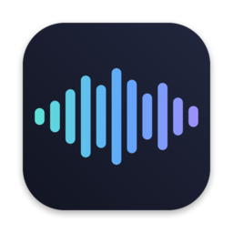
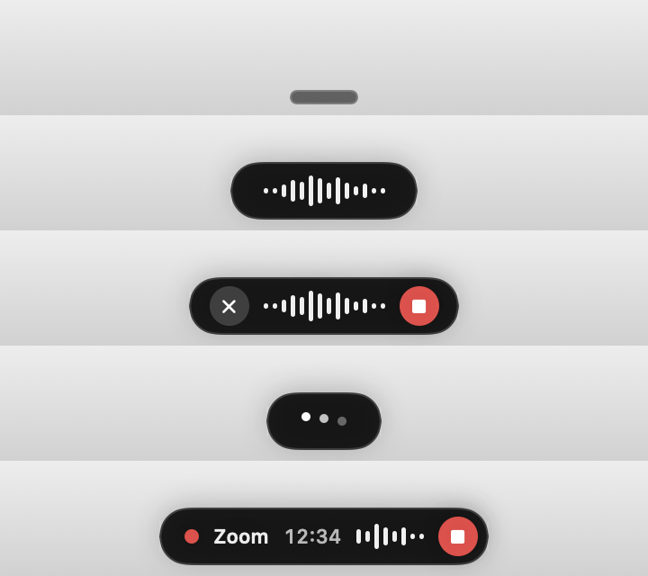
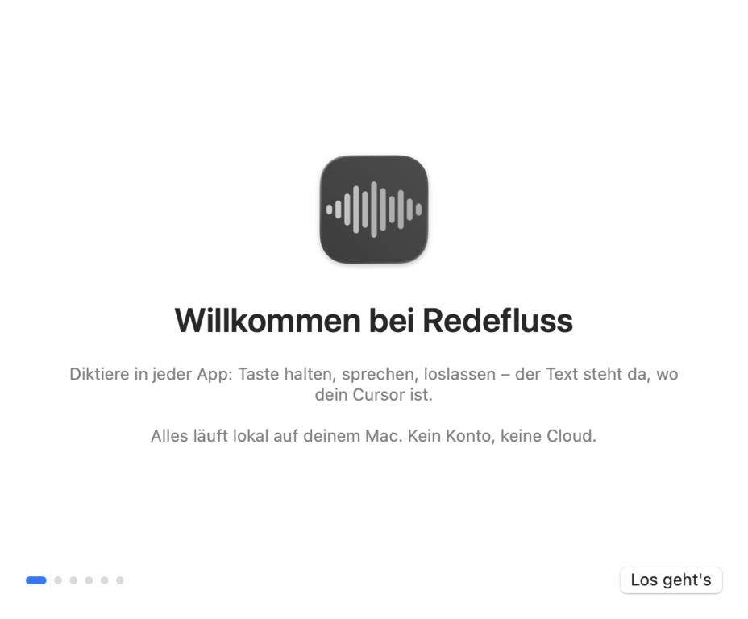
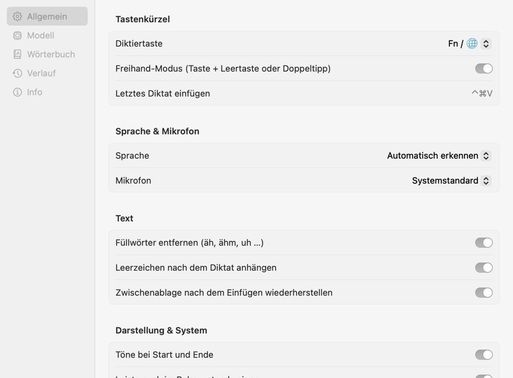
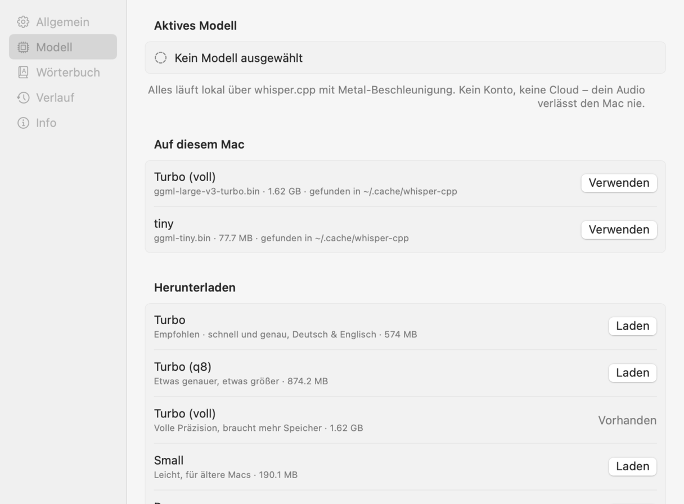

<p align="center">
  
</p>

<h1 align="center">Redefluss</h1>

<p align="center">
  <b>Diktieren in jeder Mac-App – Fn halten, sprechen, loslassen.</b><br>
  Lokal mit whisper.cpp. Kein Konto, keine Cloud, kein Abo.
</p>

<p align="center">
  <a href="https://github.com/Dream-Marketing/redefluss/releases/latest"><b>⬇ Neueste Version herunterladen</b></a>
</p>

<p align="center">
  
</p>

---

Redefluss ist eine freie, quelloffene Alternative zur Diktierfunktion von [Wispr Flow](https://wisprflow.ai) – mit dem Unterschied, dass **alles auf deinem Mac passiert**. Deine Stimme verlässt nie den Rechner.

## So funktioniert's

| | |
|---|---|
| **Fn / 🌐 halten** | Redefluss hört zu – unten erscheint die Wellenform |
| **Loslassen** | Text wird dort eingefügt, wo dein Cursor steht |
| **Fn zweimal tippen** | Dauer-Modus: freihändig sprechen, beliebig lange |
| **Fn einmal drücken** | Dauer-Modus beenden und einfügen |
| **Fn + Leertaste** | Aus dem Halten in den Dauer-Modus wechseln |
| **Esc** | Aufnahme verwerfen |
| **⌃⌘V** | Letztes Diktat noch einmal einfügen |

Funktioniert in jeder App mit Textfeld: Mail, Slack, Notizen, Browser, Word, VS Code, Terminal …

## Installation

1. **[Redefluss-x.y.z.dmg](https://github.com/Dream-Marketing/redefluss/releases/latest)** herunterladen, öffnen und **Redefluss** in **Programme** ziehen.
2. Redefluss öffnen. macOS blockiert beim ersten Mal, weil die App nicht bei Apple notarisiert ist (dafür bräuchte es ein kostenpflichtiges Entwicklerkonto):
   **Systemeinstellungen → Datenschutz & Sicherheit → ganz unten „Trotzdem öffnen"**.
   <details><summary>Alternativ per Terminal</summary>

   ```sh
   xattr -dr com.apple.quarantine /Applications/Redefluss.app
   ```
   </details>
3. Der Einführung folgen – sie dauert eine Minute:
   - **Mikrofon** erlauben
   - **Bedienungshilfen** erlauben (für die Fn-Taste und das Einfügen)
   - **Sprachmodell** laden (Turbo, 574 MB, einmalig) – liegt schon ein whisper.cpp-Modell in `~/.cache/whisper-cpp`, wird es automatisch verwendet
4. In **Systemeinstellungen → Tastatur** „🌐-Taste drücken für" auf **„Keine Aktion"** stellen – sonst öffnet sich bei jedem Diktat die Emoji-Auswahl mit.

<p align="center">
  
  
</p>

## Funktionen

- **Push-to-talk und Freihand** wie bei Wispr Flow – inklusive Doppeltipp
- **Schwebende Leiste** unten am Bildschirm mit Live-Wellenform, nimmt nie den Fokus
- **Einfügen an der Cursorposition** – die Zwischenablage wird danach wiederhergestellt und für Clipboard-Manager als vertraulich markiert
- **Automatische Spracherkennung** oder feste Sprache (Deutsch, Englisch und 12 weitere)
- **Eigenes Wörterbuch** für Namen und Fachbegriffe, dazu **Ersetzungen** („mfg" → „Mit freundlichen Grüßen")
- **Füllwörter raus** (äh, ähm, uh …) – ohne „um" oder „er" im Deutschen zu zerstören
- **Verlauf** aller Diktate, durchsuchbar, lokal gespeichert
- **Menüleisten-App**, auf Wunsch mit Autostart
- Alternativ-Tasten: rechte ⌥, rechte ⌘ oder rechte ⌃ (Fn funktioniert nur auf Apple-Tastaturen)

<p align="center">
  
  
</p>

## Modelle

| Modell | Größe | Wofür |
|---|---|---|
| **Turbo** (large-v3-turbo q5_0) | 574 MB | Empfohlen – schnell und genau für Deutsch & Englisch |
| Turbo q8 | 874 MB | Etwas genauer |
| Turbo voll | 1,6 GB | Maximale Präzision |
| Small q5_1 | 190 MB | Ältere Macs |
| Base q5_1 | 60 MB | Minimal |

Modelle kommen von [huggingface.co/ggerganov/whisper.cpp](https://huggingface.co/ggerganov/whisper.cpp) und liegen in `~/Library/Application Support/Redefluss/Models`. Mit Metal-Beschleunigung ist das Ergebnis nach etwa einer Sekunde da – gemessen: 3,6 s gesprochener Satz → 0,9 s Transkription (Turbo voll, Apple Silicon M5).

## Datenschutz

- Audio wird nur aufgenommen, solange die Taste gehalten wird bzw. der Dauer-Modus läuft.
- Die Transkription läuft vollständig lokal; es gibt keine Server, keine Telemetrie, kein Konto.
- Die einzige Netzwerkverbindung ist der Modell-Download von Hugging Face – danach funktioniert Redefluss offline.

## Häufige Probleme

**Die Fn-Taste reagiert nicht.** Prüfe in *Systemeinstellungen → Datenschutz & Sicherheit → Bedienungshilfen*, ob Redefluss eingeschaltet ist. Steht es drin, funktioniert aber nicht (typisch nach einem Update): Eintrag mit „–" entfernen und Redefluss neu hinzufügen.

**Die Emoji-Auswahl geht auf.** *Systemeinstellungen → Tastatur → „🌐-Taste drücken für" → „Keine Aktion"*.

**Im Terminal funktioniert es nicht.** Ist dort „Sichere Tastatureingabe" aktiv (Menü *Terminal*), blockiert macOS alle globalen Tastenkürzel. Das Menüleisten-Symbol zeigt das an.

**Text landet nicht im Feld.** Ohne Bedienungshilfen-Freigabe legt Redefluss den Text nur in die Zwischenablage – dann mit ⌘V einfügen.

## Selbst bauen

Voraussetzungen: macOS 14+ und Swift – die Command Line Tools reichen (`xcode-select --install`), Xcode ist nicht nötig.

```sh
git clone https://github.com/Dream-Marketing/redefluss.git
cd redefluss
make install    # baut für diesen Mac, installiert nach /Applications, lädt das Modell, startet
```

Selbst gebaute Apps werden von Gatekeeper nicht blockiert. Mikrofon und Bedienungshilfen musst du trotzdem einmal selbst erlauben.

> **Mit Claude Code:** Repo klonen, darin `claude` starten und „installier Redefluss" sagen – die `CLAUDE.md` im Repo erklärt Claude die Schritte.

```sh
make run        # baut dist/Redefluss.app für diesen Mac und startet sie
make test       # Unit-Tests (+ Ende-zu-Ende-Test, falls ein Modell in ~/.cache/whisper-cpp liegt)
make dmg        # Universal-Build (Apple Silicon + Intel) + DMG/ZIP
```

`scripts/fetch-whisper.sh` lädt das vorkompilierte [whisper.cpp-XCFramework](https://github.com/ggml-org/whisper.cpp/releases) (Metal + Core ML) mit geprüfter Checksumme nach `Vendor/`.

### Signatur und Berechtigungen

macOS merkt sich die Bedienungshilfen-Freigabe anhand der Code-Signatur. Ad-hoc-signierte Builds bekommen bei jedem Build eine neue Identität – dann muss man die Freigabe jedes Mal neu erteilen. Deshalb signieren die Releases mit einer festen, selbstsignierten Identität:

```sh
./scripts/create-signing-identity.sh   # legt ~/.redefluss-signing/ an (nicht ins Repo!)
```

Für GitHub Actions `redefluss-signing.p12` (base64) als Secret `SIGNING_P12_BASE64` und das Passwort als `SIGNING_P12_PASSWORD` hinterlegen. Ohne Secrets signiert der Release-Workflow ad-hoc.

### Release veröffentlichen

```sh
git tag v0.2.0 && git push origin v0.2.0
```

Der Workflow testet, baut die Universal-App, signiert, erzeugt DMG + ZIP und hängt beides an den GitHub-Release.

## Aufbau

```
Sources/RedeflussKit/
  Hotkey/         CGEventTap: Fn halten, Doppeltipp, Esc, ⌃⌘V
  Audio/          AVAudioEngine → 16 kHz Mono, Pegel für die Wellenform, Signaltöne
  Transcription/  whisper.cpp-Bridge, Modellverwaltung, Nachbearbeitung
  Insertion/      Zwischenablage + ⌘V (layoutunabhängig), Wiederherstellung
  UI/             Schwebende Leiste, Einstellungen, Einführung
  App/            Ablaufsteuerung, Menüleiste
```

## Lizenz

MIT. Enthält [whisper.cpp](https://github.com/ggml-org/whisper.cpp) (MIT). Redefluss ist ein unabhängiges Projekt und steht in keiner Verbindung zu Wispr Flow.
